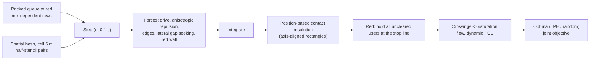
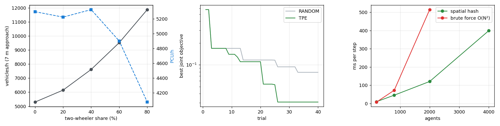

# vectorized-micromobility-physics

**Non-lane-based mixed traffic (cars, motorcycles, e-scooters, cargo bikes) at a signalised approach.**
A vectorised 2-D physics engine with anisotropic social-force interactions, lateral gap seeking and spatial
hashing reproduces filtering and seepage behaviour. It is used to measure queue-discharge saturation flow and
**dynamic PCU** factors as the two-wheeler share grows, and to calibrate the interaction parameters with
Optuna against saturation-flow targets.

**Headline:**

* **Calibration:** Bayesian (TPE) calibration hit the mixed-traffic target on held-out seeds
  (**631 vs 630 PCU/h/m**) with less than half the error of random search.
* **What it cannot fit:** the same parameters cannot also match lane-disciplined car-only traffic (744 vs 528).
  A model without composition-dependent lane discipline cannot represent both regimes.
* **Dynamic PCU:** motorcycles measure **0.17** and cargo bikes 0.45.

---

## 1. Problem formulation

In mixed traffic (South and Southeast Asia, and increasingly bike/scooter-heavy US corridors), small vehicles
do not keep lanes: they filter between cars and move to the front of the queue. Lane-based models (HCM, Vissim's
default lane logic) need PCU factors to convert this into capacity, and static PCUs ignore that the same motorcycle
uses less road at speed than at a standstill. **Dynamic PCU** (Chandra & Kumar 2003) measures it from speed and area.

| Bar | Here |
|---|---|
| **Traffic engineering** | Saturation flow per metre of approach width, dynamic PCU by vehicle type, composition sweep, calibration against planning targets |
| **ML / optimisation** | Optuna TPE vs random search on a stochastic simulator, separate calibration and validation seeds |
| **Systems** | Fully vectorised forces (NumPy scatter-add), O(N) spatial-hash neighbour search vs O(N²) brute force, position-based contact resolution for stability at dt = 0.1 s |

---

## 2. Architecture



---

## 3. Methodology

**Forces** per road user: driving $(v_0\mathbf e_x - \mathbf v)/\tau$; repulsion $w(\varphi)\,A\,e^{(r^{eff}_{ij}+0.5-d_{ij})/B}\,\mathbf n_{ij}$
with anisotropy $w(\varphi)=\lambda+(1-\lambda)\tfrac{1+\cos\varphi}{2}$, and an effective contact distance that uses
half-lengths along the direction of travel and half-widths across it (so narrow vehicles fit beside cars);
road-edge repulsion; and a lateral push toward the freer side when a slower user is directly ahead (filtering).
Overlaps are removed by a position-based projection rather than stiff springs, which keeps dt = 0.1 s stable.

**Saturation flow and dynamic PCU.** A packed queue is released at green. Flow is measured between the 10th and
90th percentile stop-line crossings, and $PCU_k = (V_{car}/V_k)/(A_{car}/A_k)$ uses mean speeds in the 30 m after
the stop line.

**Calibration.** Parameters $(A, B, \lambda, \text{lateral gain})$ minimise the mean squared relative error against
two planning targets: **528 PCU/h/m** for car-only traffic (HCM base 1,900 pc/h/ln over a 3.6-m lane) and
**630 PCU/h/m** for a 20/60/10/10 car/motorcycle/scooter/cargo-bike mix (a commonly cited Indo-HCM-style value).
Both are planning values; a real project would use field discharge counts. 40 trials per sampler, calibration seed
100, validation seeds 200-204.

---

## 4. Results ([`results/mixed_traffic/RESULTS.md`](results/mixed_traffic/RESULTS.md))



### 4.1 Calibration (held-out seeds)

| Mix | Target (PCU/h/m) | Default parameters | Calibrated (TPE) |
|---|---|---|---|
| Mixed 20/60/10/10 | 630 | 679 (+8%) | **631 (+0.2%)** |
| Car only | 528 | 907 (+72%) | 744 (+41%) |

TPE reached a joint objective of 0.031 vs 0.079 for random search in the same 40 trials. Calibrated parameters:
A = 2.05 m/s², B = 0.33 m, λ = 0.52, lateral gain = 0.70.

**The car-only miss is structural, not a tuning failure.** On a 7-m approach this physics lets cars pack three
abreast, as they would in non-lane-based traffic, while lane-disciplined car traffic runs two lanes. No setting of
these four parameters represents both regimes. The fix is a composition-dependent lane-discipline term, which is the
next model addition. This is the same reason one calibrated Vissim behaviour set rarely transfers between very
different traffic mixes.

### 4.2 Composition sweep (calibrated, 7-m approach)

| Two-wheeler share | Vehicles/h | PCU/h | Mean PCU factor | Dynamic PCU: motorcycle / scooter / cargo bike |
|---|---|---|---|---|
| 0% | 5,298 | 5,298 | 1.00 | - |
| 20% | 6,147 | 5,224 | 0.85 | 0.18 / 0.12 / 0.52 |
| 40% | 7,616 | 5,326 | 0.70 | 0.17 / 0.11 / 0.45 |
| 60% | 9,519 | 4,901 | 0.52 | 0.17 / 0.11 / 0.45 |
| 80% | 11,873 | 4,074 | 0.34 | 0.17 / 0.10 / 0.45 |

* **Vehicle throughput more than doubles** (5,298 → 11,873 veh/h) as two-wheelers replace cars, because they fill
  the gaps between cars.
* **PCU throughput peaks around 40% and then falls.** Once two-wheelers dominate, the approach discharges many
  small units slowly, and PCU/h is no longer a stable capacity measure, which is the argument for reporting both.
* **Dynamic PCUs are stable across mixes** (motorcycle 0.17-0.18), consistent with the low dynamic PCU values
  reported for two-wheelers in mixed-traffic studies.

### 4.3 Scaling

| Agents | Spatial hash (ms/step) | Brute force (ms/step) |
|---|---|---|
| 200 | 9.7 | 7.6 |
| 800 | 45.3 | 72.4 |
| 2,000 | 120.5 | 515.0 (**4.3× slower**) |
| 4,000 | 399.1 | - |

Below about 400 agents the hash's bookkeeping costs more than it saves; above that it wins by a growing margin.

---

## 5. Layout, reproduce, limitations

```
src/micromob/engine.py       vehicle types, forces, spatial hash, contact projection, queue builder
src/micromob/experiments.py  discharge, dynamic PCU, calibration objective
src/micromob/study.py        calibration (TPE vs random), sweep, benchmark, report ; api/app.py ; cli.py
tests/ (5 tests: neighbour completeness, red holds the queue, no overlaps, discharge and PCU sanity, API)
```

```bash
python -m venv .venv && .venv/Scripts/activate
pip install -r requirements.txt && pip install --no-deps -e .
pytest && micromob study --trials 40 --seeds 5      # ~20 min
```

**Limitations.** Planning-value targets (not field data); rectangles axis-aligned to the road (no yawing during
lane changes); no turning movements or opposing flows; the 1-D lateral seeking rule is simple compared with gap-acceptance models.

## License

MIT
