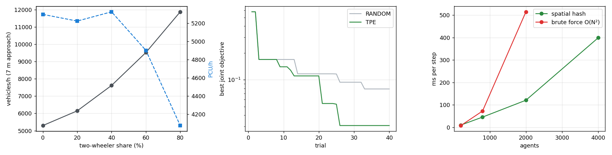

# Mixed-traffic results

Calibration: 40 trials each (TPE vs random) on seed 100; best = TPE (objective TPE 0.0307, random 0.0790). Wall time 1247 s.

| Parameter | Default | Calibrated |
|---|---|---|
| a | 3 | 2.05 |
| b | 0.6 | 0.333 |
| lam | 0.15 | 0.524 |
| lateral_gain | 0.6 | 0.7 |

## Held-out validation (seeds 200-204)

| Mix | Target (PCU/h/m) | Default | Calibrated |
|---|---|---|---|
| Car only | 528 | 907 | 744 |
| Mixed (20/60/10/10) | 630 | 679 | 631 |

## Two-wheeler share sweep (calibrated, 7 m approach)

| Two-wheeler share | Vehicles/h | PCU/h | Mean PCU factor | PCU motorcycle | PCU scooter | PCU cargo bike |
|---|---|---|---|---|---|---|
| 0% | 5298 | 5298 | 1.00 | - | - | - |
| 20% | 6147 | 5224 | 0.85 | 0.18 | 0.12 | 0.52 |
| 40% | 7616 | 5326 | 0.70 | 0.17 | 0.11 | 0.45 |
| 60% | 9519 | 4901 | 0.52 | 0.17 | 0.11 | 0.45 |
| 80% | 11873 | 4074 | 0.34 | 0.17 | 0.10 | 0.45 |

## Scaling

| Agents | Spatial hash (ms/step) | Brute force (ms/step) |
|---|---|---|
| 200 | 9.7 | 7.6 |
| 800 | 45.3 | 72.4 |
| 2000 | 120.5 | 515.0 |
| 4000 | 399.1 | nan |

